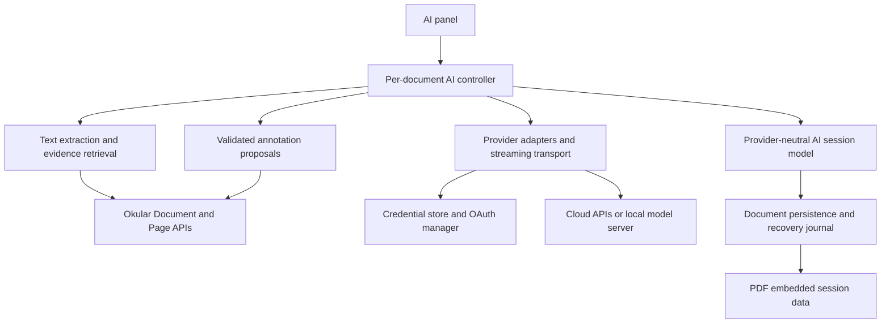

<!--
SPDX-FileCopyrightText: 2026 Georgios Kouros
SPDX-License-Identifier: GPL-2.0-or-later
-->

# AI assistance for OkulAIr: architecture and implementation plan

Status: target architecture with an experimental first implementation.
The prototype uses a page-one text note instead of a document attachment,
manual API connections, full-text context with a size limit, and explicit PDF
saving. See [development and usage](../development.md) for implemented behavior
and outstanding capabilities. The remaining sections describe the target design.
Prepared: 2026-11-17. Repository inspected at `990b91959`.

## Product outcome

OkulAIr is an independent fork of Okular. Add a native AI panel for reading a
scientific PDF: ask questions, generate a
short critical summary, and highlight important passages. Reopening the saved
PDF restores conversations, summaries, and generated annotations without a
provider connection or the original computer. Users can switch providers while
keeping the same conversation history.

The PDF is the portable source of truth. A local recovery journal protects work
between PDF saves; a local index accelerates retrieval. Neither replaces the
embedded record. Provider-side conversation storage is optional and never
required to reopen a conversation.

## Proposed user experience

Start with an **AI Assistant** tab in the existing sidebar. This fits Okular's
current widget structure and gives a small initial change. A separate right-hand
panel can follow so thumbnails or contents remain visible alongside chat.

The panel contains:

- A provider/account and model selector, plus connection settings.
- Conversation history with streaming answers and clickable page citations.
- A question composer, Send, Stop, and Retry controls.
- **Summarize paper** and **Highlight key passages** buttons.
- Context choices: document, current page, or selected text.
- A compact save indicator: Saved in PDF, Saving, Recovery copy only, or Failed.
- Thread selection, export to Markdown/JSON, and remove AI data from this PDF.

Use native Qt widgets and KDE localization/accessibility conventions. Rendering
must not fetch external Markdown images, execute HTML, or activate links without
user interaction. Model output remains editable text with inspectable sources.

Connection setup happens once per provider/account. Future launches reuse the
connection securely where supported. Initial authentication still requires the
user's credentials or browser consent. Opening a PDF alone never starts inference
or sends its text to a service.

## Provider and authentication strategy

Separate provider protocol, authentication, and inference capabilities.

| Connection | Initial setup | Planned behavior |
| --- | --- | --- |
| OpenAI API | User's API key | Responses API adapter; API usage and billing |
| ChatGPT plan | Continue with ChatGPT in system browser | Separate SIWC authentication profile and request policy; eligible account/workspace required |
| Anthropic API | User's API key | Native Messages adapter; API usage and billing |
| Local Ollama | Select endpoint and installed local model | Local inference without a provider account |
| Other compatible servers | Endpoint, model, optional credential | Capability-tested adapter for a documented compatible API subset |

OpenAI now documents Sign in with ChatGPT (SIWC) for open-source and locally
hosted apps, including permission to use a ChatGPT plan for eligible Responses
requests. This is a distinct integration, not permission to reuse browser cookies
or arbitrary ChatGPT tokens. The documented flow uses browser authorization,
PKCE, validated OIDC identity, a stable installation host ID, and a per-account
issued client ID. Plan-use scopes must be granted; identity sign-in alone is
insufficient. Verify availability in a feasibility prototype before promising it
in a release. Sources: [overview][siwc], [registration][siwc-signin].

SIWC currently requires streaming, `store: false`, and client-supplied history.
Its unsupported fields/tools differ from ordinary API access. Give this profile
its own request builder and tests rather than forwarding a generic OpenAI JSON
body. Local document retrieval avoids depending on hosted file search, which is
not supported by this flow. Source: [preview limitations][siwc-limits].

Anthropic's published policy directs third-party applications to API keys or
supported cloud-provider authentication and restricts offering Claude.ai login
or routing through subscription credentials. Do not promise equivalent Claude
subscription sign-in. Embedding the unmodified Claude Code application is a
different integration with its own requirements, outside this first design.
Sources: [credential-use policy][claude-policy], [API authentication][claude-auth].

Ollama documents a partially OpenAI-compatible API and an unauthenticated local
endpoint. A localhost endpoint can also proxy a cloud model: local transport does
not establish that inference is local. Show whether the configured model is
local/cloud when known and require a verified local configuration for an offline
mode. Sources: [compatibility][ollama-compat], [authentication][ollama-auth].

Store credentials and refresh tokens in KWallet where available, with a platform
credential-store abstraction. If secure storage is unavailable, offer session-only
credentials rather than silently writing plaintext settings. Keep keys bound to
the selected endpoint/account; never forward them across redirects or to a newly
edited endpoint. Do not bundle a shared developer key. No credentials, host IDs,
emails, or OAuth tokens belong inside the PDF. OpenAI API authentication is
documented in the [official API reference][openai-auth].

## Architecture and repository integration

The following are proposed ownership boundaries, not existing classes:

| Area | Proposed code | Existing integration |
| --- | --- | --- |
| Desktop UI | `part/ai/assistantwidget.*`, `connectiondialog.*` | Register from `part/part.cpp`; existing `Sidebar::addItem()` in `part/sidebar.h` |
| Orchestration | `part/ai/assistantcontroller.*` | `DocumentObserver` lifecycle, selected-text actions, cancellation |
| Portable domain model | `core/ai/session.*`, `sessionserializer.*` | Versioned messages, summaries, evidence anchors, annotation provenance |
| Document context | `core/ai/documentcontext.*` | `Document::requestTextPage()`, `Page::text()`, `Page::words()`, `Page::findText()` |
| Inference | `part/ai/providers/` | Qt asynchronous networking, per-provider protocol and capability handling |
| Credential management | `part/ai/credentials.*`, `chatgptauth.*` | Existing optional KWallet dependency; browser OAuth and token renewal |
| PDF storage | Proposed generator persistence capability | `core/document.*`, generator interface, `generators/poppler/generator_pdf.*` |
| Annotation generation | `part/ai/annotationproposals.*` | `HighlightAnnotation`, `Document::addPageAnnotation()`, undo commands |
| Configuration/tests | `conf/`, `CMakeLists.txt`, `autotests/` | Feature option, settings, mocked provider and PDF integration tests |

Keep provider/network logic out of the PDF generator. Keep portable schema and
document persistence independent of the desktop widget so a future mobile UI can
reuse them. Use a build option to omit AI networking/UI; core must still preserve
embedded data when possible. No Python service, web UI framework, vector database,
or agent framework is needed for the first version.

Providers expose model listing where available, streaming text, cancellation,
usage reporting, errors, and capabilities such as image input, structured output,
context budget, and request limits. OpenAI compatibility is a protocol subset,
not a promise of identical capabilities. Use explicit model IDs selected by the
user and a manual-entry fallback; do not bake in a supposedly permanent best model.

Give every request a document generation ID, thread ID, and request ID. A document
close, reload, replacement, account change, or Stop invalidates the appropriate
request. A late callback must never write into another PDF. Handle network errors,
rate limits, token expiry, and partial output without losing the existing thread;
avoid automatic billable retries after output has started.

## Persistence: prove this first

### What the inspected code supports

- `part/part.cpp` constructs sidebar tabs and coordinates saving via the document
  and KIO path.
- `Document::embeddedFiles()` and `PDFGenerator::embeddedFiles()` expose existing
  attachments; `EmbeddedFile` is a read-oriented abstraction.
- `FileAttachmentAnnotation::setEmbeddedFile()` exists, but
  `PopplerAnnotationProxy::notifyAddition()` in `generators/poppler/annots.cpp`
  does **not** handle `AFileAttachment`. Adding a widget and calling that setter
  will not establish working PDF persistence.
- `PDFGenerator::save()` uses Poppler's PDF converter with `WithChanges`.
- `Document::SaveCapability` currently covers forms and annotations. A dedicated
  AI-data persistence capability/extension needs a deliberate interface design.
- `DocumentPrivate::saveDocumentInfo()` explicitly says new annotations/forms
  are no longer stored in local docdata; that path mainly handles document state
  and legacy migration. It does not satisfy portable conversation storage.

### Recommended storage

Use a namespaced, versioned JSON attachment, conceptually
`okular-ai-session.json`, embedded at document level. Match by format identifier
and schema, not filename alone. Keep all ordinary PDF attachments intact.
Store highlights as standard PDF highlight annotations so other readers display
them normally. Keep model provenance and evidence associations in the JSON,
linked through stable annotation identifiers.

First verify whether the supported Poppler Qt API can create, replace, and remove
document attachments and persist them through the current save/backing-file
workflow. The inspected Okular code does not establish that it can. If Poppler
needs an extension, implement/upstream that boundary or evaluate a narrowly
scoped PDF-writing dependency. Any writer must participate in the same save
transaction as annotations/forms and preserve encryption and unrelated content.
Avoid an independent post-save rewrite from the panel.

A fallback prototype can store a bounded session in a clearly labeled standard
text-note annotation, which already has a write path. It needs round-trip and
size testing and exposes the payload in other readers. It is a feasibility aid,
not the preferred long-term format. A sidecar-only release would not meet the
requirement that the conversation travel inside the PDF.

### Data model

The versioned record contains:

- Format identifier, schema version, session UUID, revision, creation/update times.
- Document content fingerprint and extraction-version identifier.
- Threads and messages with UUIDs, role, visible text, time, model/provider label,
  parent relationships, completion status, and optional reported token usage.
- Summaries with source coverage, evidence references, prompt-template version,
  model identity, and user edits.
- Evidence anchors: physical page index, displayed page label, exact quote,
  surrounding context, normalized unrotated geometry, and text fingerprint.
- Annotation IDs, proposal batch IDs, accepted/rejected status, rationale, and
  whether an AI-generated annotation has subsequently been edited by a person.

Do not serialize hidden reasoning or credentials. Do not embed a duplicate full
PDF text index by default. UUIDs and revisions enable recovery reconciliation;
multiple threads permit separate reading questions and critical-review sessions.

Compute a semantic content fingerprint from relevant page content/text and page
geometry, excluding the embedded AI data; hashing the entire saved PDF would
change on every session save. A separate byte fingerprint can detect external
file changes for write-conflict handling. Revalidate anchors after page insertion,
reordering, OCR replacement, or content edits. Surface stale evidence rather than
silently linking to a different passage.

### Save and recovery behavior

1. Write accepted user input and streamed partial output to an atomic local
   recovery journal; debounce writes rather than rewriting a PDF per token.
2. Commit completed turns, summary edits, and annotation batches into the
   document model and mark it modified. Preserve cancelled/incomplete turns as
   such; do not present them as completed responses.
3. Offer per-document **Automatically save AI work**. For a writable ordinary
   local PDF, debounce a completed operation into the normal save workflow. Make
   clear this saves the entire modified document, including pending manual edits.
4. Save AI data and annotations as one coherent revision. Retain the journal
   until the save and backing-file handoff succeed. Serialize concurrent saves
   and distinguish later changes from the revision actually saved.
5. On normal close, finish the save or show the existing save/error flow. On
   reopen, load embedded history even while offline; offer recovery of newer
   journal changes with conflict detection.

PDF autosave is not a silent default for signed, read-only, remote, or externally
changed files. Offer an AI-enabled writable copy where needed and label local-only
recovery honestly. Integrate signature/change restrictions and existing save
handling; do not claim a rewrite preserves signatures. Never overwrite an
external modification without resolving it. Support Save As, moving/renaming the
PDF, and copying it to another machine.

Use bounded parsing and attachment-size limits. Unknown newer schemas should
remain preserved but read-only. An existing PDF editor may strip the attachment,
and deletion may leave older data in incremental PDF revisions: provide explicit
export and explain that full sanitization requires rewriting/history handling.
Sharing a PDF containing the session shares the conversation as well.

## Document grounding and scientific answers

Extract text through Okular's document APIs and retain page/word geometry. Work
incrementally and respect the generator's threading and lifetime rules; the UI
must remain responsive. Preserve a mapping between normalized search text and
original characters so ligatures, line breaks, hyphenation, and columns do not
break highlights.

For short papers, include the full paper if it fits the selected model's context
budget. For longer documents, use section/page-aware chunks and initial lexical
retrieval; add local embeddings only when evaluation shows a benefit. Retrieve
from follow-up questions plus relevant chat context. Budget document evidence,
history, instructions, and output together, with a visible scope/coverage label.
Do not silently submit the first N characters and claim to have read the paper.

Return evidence IDs linked to supplied passages. Validate that IDs, page indices,
and quotes exist before making them clickable. Quote matching establishes an
anchor, not the truth or logical support of a claim; evaluate claim support
separately. State when an answer is an interpretation or when the supplied
document does not contain enough evidence. No arbitrary confidence percentages.

Text extraction alone cannot reliably interpret diagrams, image tables, or
complex equations. Detect image-only or poorly extracted pages. Show coverage
gaps; a later OCR/vision path can process selected pages with explicit provider
and data-transmission choices. Never imply a text-only answer interpreted every
figure.

Treat document text as untrusted evidence, including instructions embedded in a
paper. This feature requires no shell, arbitrary filesystem, browser automation,
or executable model tools. Send document content only for a user-triggered task;
show the destination and scope on first cloud use and when either changes.
Cloud restrictions and offline mode should be enforceable settings.

## Automatic highlighting

The button proposes a small configurable set of important phrases: contributions,
method definitions, principal results, and limitations. The model returns
structured candidates containing a supplied passage ID, exact quote, category,
and short rationale. It never chooses arbitrary page coordinates.

Resolve each quote against the extracted page text, requiring a unique match or
enough surrounding context to disambiguate. Map it to actual word geometry and
construct standard `HighlightAnnotation` quads using Okular's coordinate
conventions. Reject missing or ambiguous quotes; never highlight an invented
phrase. Test multi-line, multi-column, rotated, and non-Latin text explicitly.

Default to a preview with checkboxes and Apply selected; offer **Apply
automatically** as a user preference. Limit density and deduplicate by existing
annotation IDs/anchors. Batch creation must be one undoable operation, including
provenance updates. The current public Document API adds annotations individually;
introduce a batch/command facility rather than assuming a public undo macro API
already exists. Refresh the proposal/session model when users undo, delete, or
manually edit generated annotations. Respect annotation permissions.

## One-paragraph summary

Generate approximately 120–180 words covering the research question, approach,
main findings, and practical takeaway. Include the most consequential limitation
within the paragraph, with compact page citations. Keep the paragraph editable
and retain its original version and provenance.

Distinguish **author-stated limitations** from **assistant-inferred concerns**.
For example, absent external validation is an inferred concern only after checking
relevant methods/results/supplement material; if coverage is incomplete, say it
was not found in the supplied text. Do not turn missing evidence into a definitive
claim about the experiment. Never invent metrics or infer universal validity from
a narrow result.

For long papers, summarize sections with evidence and synthesize the paragraph
from those notes. Record coverage and missing supplements. The synthesis must
include methods, results, and limitations rather than relying on the abstract.

## Delivery sequence and acceptance gates

| Phase | Deliverable | Required acceptance evidence |
| --- | --- | --- |
| 0. Feasibility | PDF storage round trip; provider/auth probes; build setup | Session survives save/reopen and copying; manual annotations/forms/attachments survive; one SIWC eligible-model response or a documented access blocker |
| 1. Offline foundation | Session schema, serialization, lifecycle, journal, sidebar reading | Embedded fixtures reopen offline; save failures/recovery/schema migration work; document switching cannot mix sessions |
| 2. Grounded chat | OpenAI API, Anthropic, local compatible adapter; SIWC profile where proven | Streaming/Stop/Retry, credential isolation, bounded context, follow-up questions, citations, provider switching |
| 3. Critical summary | Button, paragraph editing, evidence and coverage | Goals/findings/limitations retained after reopen; stated and inferred limitations separated |
| 4. Highlights | Structured proposals, geometry validation, preview/apply, batch undo | No hallucinated/ambiguous spans applied; undo/redo and manual edits persist correctly |
| 5. Release hardening | Autosave, Save As, accessibility, packaging, documentation | Fault-injection/save tests, signed/read-only/encrypted behavior, cross-machine offline reopening, stable non-AI workflows |

Phase 0 should be time-boxed and reported before committing to a release date:
attachment writing and account availability can change the remaining work. Start
testing local inference early so development is not blocked by cloud credentials.
This checkout requires Qt 6.8+ and KDE Frameworks 6.13+ according to CMake; establish
a supported build environment before implementation. No build was attempted for
this design-only task.

Use deterministic fake providers and local HTTP/SSE fixtures for automated tests;
live credentials must not be a CI dependency. Test malformed, truncated,
oversized, interrupted, and rate-limited responses and expired/revoked credentials.
Use PDF fixtures for normal text, multi-column text, rotated pages, scans,
encryption, existing attachments/forms/highlights, and signatures. Check that
opening or saving with AI disabled preserves session data where supported and
does not send network requests.

Evaluate answer quality on a small annotated set of scientific papers: citation
validity, claim support, coverage, summary factuality, limitation attribution, and
highlight relevance/density. Record latency and actual provider-reported usage
where available. A valid JSON response or a matching quote is not sufficient
evidence of scientific usefulness.

## Further enhancements, in recommended order

1. **Explain this selection:** definitions, equations, and plain-language
   explanations with surrounding context and a persistent link back to the text.
2. **Evidence inspection:** clicking a claim shows its supporting quotes and page
   regions; users can flag unsupported answers and save corrections.
3. **Structured critical appraisal:** study design, data, splits, baselines,
   leakage risks, uncertainty, external validation, and reproducibility checklist,
   each with evidence or an explicit unknown.
4. **Figure and table questions:** selected-region vision, table extraction, and
   links between results prose and the actual plot/table.
5. **Reproducibility notes:** extract datasets, code links, dependencies,
   hyperparameters, and experimental omissions into an editable checklist.
6. **Compare papers:** a separate library-level workspace links documents and
   evidence. Embed each paper's own history and export shared comparison data;
   do not hide unrelated PDFs inside one paper's session.
7. **Research-note export:** Markdown/LaTeX notes with citations and optional
   Zotero integration; preserve the distinction between paper content and AI
   commentary.
8. **Reading tutor:** glossary, prerequisite explanations, self-test questions,
   translation alongside the original, and a reading-progress summary.

## References

[openai-auth]: https://developers.openai.com/api/reference/overview#authentication
[siwc]: https://developers.openai.com/siwc/token-sharing-open-source
[siwc-signin]: https://developers.openai.com/siwc/token-sharing-open-source/sign-in
[siwc-limits]: https://developers.openai.com/siwc/token-sharing-open-source/preview-limitations
[claude-policy]: https://code.claude.com/docs/en/legal-and-compliance#authentication-and-credential-use
[claude-auth]: https://platform.claude.com/docs/en/manage-claude/authentication
[ollama-compat]: https://docs.ollama.com/api/openai-compatibility
[ollama-auth]: https://docs.ollama.com/api/authentication
